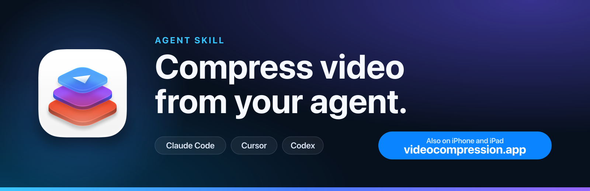

# Video Compressor Agent Skill

<p align="center"><a href="https://www.videocompression.app/?utm_source=github&utm_medium=readme&utm_campaign=agent-skill"></a></p>

<p align="center"><a href="#install"><b>Install the skill</b></a> · <a href="https://apps.apple.com/app/id6810118769?pt=117264678&ct=agent-skill_readme-top_001"><b>Get the iPhone app</b></a> · <a href="https://www.videocompression.app/?utm_source=github&utm_medium=readme&utm_campaign=agent-skill"><b>videocompression.app</b></a></p>

I built this [Agent Skill](https://agent-plugins.org) to let your agent compress video files for you. It checks what your machine can do,
decides which files are worth compressing, encodes them to HEVC (or H.264), verifies every result and leaves the original untouched.

It works with Claude Code, Cursor, Codex and any agent that reads `SKILL.md`. It is one Python 3 file with no dependencies, it makes no
network calls unless you ask for one, and it sends nothing anywhere.

> **Do you have videos on an iPhone or iPad?** The skill cannot reach the Photos library of a phone, so I built
> [Video Compressor](https://www.videocompression.app/?utm_source=github&utm_medium=readme&utm_campaign=agent-skill) for that. It compresses the
> videos on the device itself, and the presets in this skill follow the same preset logic.
>
> <a href="https://apps.apple.com/app/id6810118769?pt=117264678&ct=agent-skill_readme-callout_001"></a>

## What it does

- **Decides before it encodes.** Files that are already efficient are skipped, so a re-encode never makes a file bigger.
- **Four presets** (`premium`, `high`, `balanced`, `max-saving`) that follow the preset logic of my Video Compressor iPhone app.
- **Size targets.** Fit a clip under Discord, WhatsApp, email or Slack limits, or any number of megabytes, with bitrate math and two-pass encoding.
- **Verifies every output.** Duration, audio, frame rate, resolution and size are checked. A failed output is deleted and the original is never touched.
- **Handles iPhone footage.** HEVC is tagged `hvc1`, HDR stays HDR, rotation and metadata are kept, and Live Photo, Cinematic and
  spatial videos are skipped instead of damaged.
- **Works without ffmpeg when it has to.** It falls back to macOS `avconvert`, and without any encoder it prints exact commands for you to run.
- **Batch mode.** Point it at a folder.

## Install

### skills.sh

```bash
npx skills@latest add AvdLee/Video-Compression-Agent-Skill
```

### Claude Code

```bash
/plugin marketplace add AvdLee/Video-Compression-Agent-Skill
/plugin install video-compression@video-compression-agent-skill
```

### Cursor

Load the plugin from a local clone by placing it in `~/.cursor/plugins/local`. Cursor reads `.cursor-plugin/plugin.json` and the
portable `plugin.json` in this repository.

### Codex and OpenAI agents

Use the skills.sh command above, or copy `skills/video-compression` into the folder your agent reads skills from. The Codex
manifest is `.codex-plugin/plugin.json`.

Other clients (pi, Gemini CLI, Autohand Code, manual installation) are listed in [INSTALLATION.md](INSTALLATION.md).

### Requirements

`ffmpeg` and `ffprobe` give you every feature. Install them yourself with `brew install ffmpeg` (macOS), `winget install Gyan.FFmpeg`
(Windows) or your Linux package manager. The skill never installs software on its own. Without them it uses macOS `avconvert` or switches
to advisor mode. See [How it decides](#how-it-decides).

## Example prompts

- `Compress this video so it is much smaller but still looks the same.`
- `Fit this screen recording under the Discord upload limit.`
- `Compress every video in this folder and tell me which ones were not worth compressing.`
- `Why is this 4K clip 2 GB? Check the bitrate and shrink it without visible quality loss.`
- `Convert this video to H.264 so it plays on an old TV.`

## How it decides

The skill runs five steps: `doctor`, `probe`, `plan`, `run`, `verify`.

| Tier | What is available | What the skill does |
| --- | --- | --- |
| 1 | Local machine with `ffmpeg` and `ffprobe` | Everything, including size targets and batches. |
| 1b | macOS with only `avconvert` | Four fixed presets. No size targets. |
| 2 | `ffmpeg` without `ffprobe` (hosted sandbox) | Short clips only, with a reduced probe. |
| 3 | No encoder | Advisor mode: bitrate math and exact commands for macOS, Linux and Windows. |

A file is skipped, with a reason, when:

- it is already efficient for the chosen preset (`already_efficient`, `below_bitrate_floor`, `premium_efficient_hevc`),
- the saving would be under 10% (`no_meaningful_savings`),
- it is a Live Photo video, Cinematic or spatial video, or Dolby Vision profile 5 (the format would not survive a normal encode),
- or the result would not be smaller than the original (`not_smaller`, the output is deleted).

The rules, what I mirrored from the app and what is the skill's own calibration are documented in
[presets.md](skills/video-compression/references/presets.md).

## Benchmark

I measured this on 2026-10-30 with [`tools/benchmark.py`](tools/benchmark.py) on 8 real iPhone 15 Pro clips (H.264, 1080p, about 205 seconds in
total) and on the 8 `balanced` outputs of those clips (already compressed once). I ran it on a Mac with `hevc_videotoolbox`, and quality is
VMAF on a centered crop of the first 15 seconds. Full tables and the method are in [benchmark.md](skills/video-compression/references/benchmark.md),
raw numbers in [benchmark-results.json](skills/video-compression/references/benchmark-results.json).

**Clips as recorded (8 clips)**

| Mode | Size saving, median (min to max) | VMAF, median |
| --- | --- | --- |
| `premium` | 41.1% (40.0% to 42.4%) | 94.8 |
| `high` | 52.5% (51.1% to 52.8%) | 93.2 |
| `balanced` | 60.7% (58.7% to 61.5%) | 91.8 |
| `max-saving` | 85.7% (84.8% to 86.0%) | 80.6 |
| `balanced` with `--software` (libx265) | 62.1% (55.9% to 65.4%) | 95.3 |
| plain `ffmpeg -crf 23` with libx264 | 67.2% (48.2% to 77.8%) | 93.7 |
| plain `ffmpeg -crf 23` with libx265 | 73.3% (48.1% to 84.1%) | 94.1 |

**Clips that were already compressed once (8 clips)**

| Mode | Result |
| --- | --- |
| `premium` and `high` | 8 of 8 skipped as already efficient |
| `balanced` | Re-encoded, median saving 35.0% |
| plain `ffmpeg -crf 23` with libx264 | 3 of 8 files got bigger |
| plain `ffmpeg -crf 23` with libx265 | 1 of 8 files got bigger |

On fresh iPhone footage a plain `-crf 23` re-encode saves as much or more than the presets. I did not build a better encoder. What the skill
adds is the decision about whether to encode at all, size targets, correct tags and metadata, HDR handling and verification. On other content
(screen recordings, animation, small web videos) results will differ.

## FAQ

### How do I compress a video with an AI coding agent?

Install the Video Compressor skill, then ask your agent to compress the file. The agent runs `doctor`, `probe`, `plan`, `run` and `verify`,
and writes `<name>.compressed.mp4` next to the original.

### Does Video Compressor change or delete my original video?

No. The original is never modified, moved or deleted. Outputs are written as `<name>.compressed.mp4`, and an existing file with that name is never overwritten.

### Will compressing make my video worse?

The presets aim for a smaller file at a similar look, and the benchmark above lists the measured VMAF per preset. `max-saving` is the
softest preset on purpose. If you want quality first, use `premium` or `high`.

### Can it compress a video to fit under a size limit?

Yes. Use `--target discord`, `--target whatsapp`, `--target email`, `--target slack` or `--target-mb N`. The limits and their sources are in
[platform-limits.md](skills/video-compression/references/platform-limits.md).

### Does it work without ffmpeg?

Partly. On macOS the Video Compressor skill can use the built-in `avconvert` with fixed presets. Without any encoder it switches to advisor
mode and prints the exact commands. It will not install ffmpeg unless you pass `--allow-download` and agree to a pip download into the skill folder.

### Does it work with HDR and Dolby Vision iPhone videos?

Yes, with limits. HDR clips keep 10-bit HEVC and their color tags. Dolby Vision profile 8 keeps the HLG base layer and drops the Dolby Vision
metadata. Dolby Vision profile 5 is skipped. Details are in [apple-video.md](skills/video-compression/references/apple-video.md).

### Does it send my videos anywhere?

No. Everything runs locally. I did not add any telemetry, and the only network use is the optional `--allow-download`.

## Compress on your iPhone

The skill works on files on a computer. For videos on an iPhone or iPad, use the
[Video Compressor app](https://apps.apple.com/app/id6810118769?pt=117264678&ct=agent-skill_readme_001) I built. Product page and guides:
[videocompression.app](https://www.videocompression.app/?utm_source=github&utm_medium=readme&utm_campaign=agent-skill).

## About me

I'm Antoine van der Lee, an indie developer who has been building iOS apps since 2009. I worked on Videoland, the Dutch streaming service, so
playback, codecs and storage are familiar ground. I have also been editing video for a long time and have made several podcasts, including
[Going Indie](https://podcast.going-indie.com/), which I host in audio and video.

You can read more on my [About page](https://www.videocompression.app/about/?utm_source=github&utm_medium=readme&utm_campaign=agent-skill).

## Development

```bash
python3 -m unittest discover -s tests -v
python3 -m compileall skills/video-compression/scripts tests tools
```

The tests need `ffmpeg` and `ffprobe` and generate their own clips in a temporary folder. See [CONTRIBUTING.md](CONTRIBUTING.md).
GitHub topics and listing notes are in [docs/github-topics.md](docs/github-topics.md).

## License

MIT. See [LICENSE](LICENSE).
